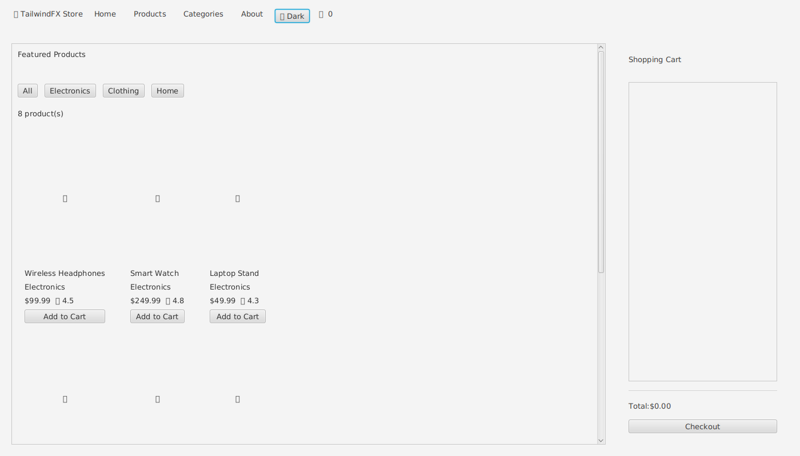
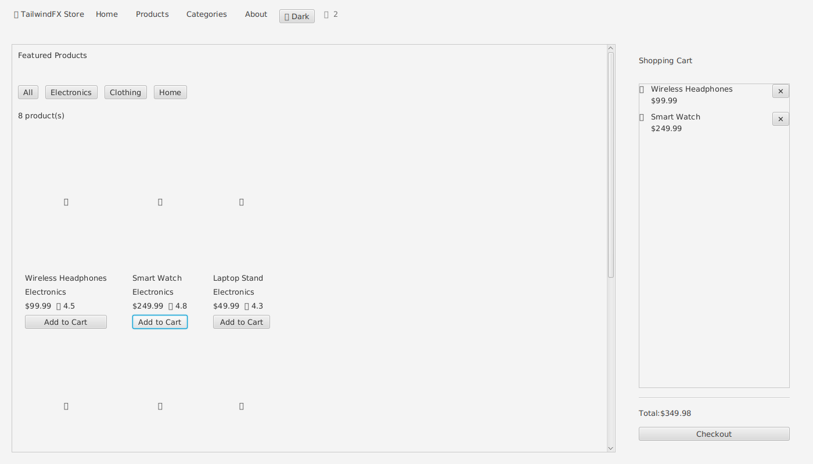
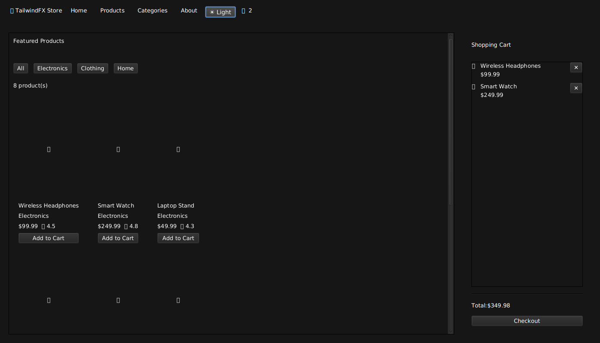

# TailwindFX E-commerce Demo

A complete e-commerce product page built with TailwindFX, demonstrating the framework end to end:
utility-first styling, pre-built components, theming, animation and responsive design.

## Screenshots

| Light theme | Cart with items | Dark theme |
|-------------|-----------------|------------|
|  |  |  |

## Features

- **Product grid** — responsive 3-column `GridPane` of product cards with image placeholder, name,
  category, price and rating.
- **Category filters** — `All`, `Electronics`, `Clothing`, `Home`; the grid and the result count
  update immediately.
- **Shopping cart sidebar** — running total, per-item remove buttons, collapsible via the header
  cart icon, empty-cart warning.
- **Add-to-cart feedback** — the cart icon pulses and the clicked button pops (`TwAnimation`).
- **Checkout form with validation** — name, email, address and 16-digit card number; invalid fields
  are highlighted (`TwInput.setError`), an error alert is shown and the form shakes
  (`TwAnimation.shake`). Valid input places the order and shows a success alert.
- **Light/dark theme switching** — one click toggles between themes with an animated transition
  (`TwTheme`).
- **Responsive design** — `ContainerQuery` adjusts padding at the `md` and `lg` breakpoints.
- **Headless UI tests** — `EcommerceDemoIT` drives the real scene graph with TestFX (Monocle).

## Requirements

- Java 17
- Maven 3.8.7+

## Running

From the repository root, build the required modules once:

```bash
mvn -P examples -pl examples/ecommerce-demo -am -DskipTests install
```

Then launch the application:

```bash
cd examples/ecommerce-demo
mvn javafx:run
```

## Running the tests

The UI tests use TestFX with the Monocle headless backend, so no display or Xvfb is required:

```bash
mvn -P examples -pl examples/ecommerce-demo verify
```

## How it is built

The demo composes TailwindFX utilities and components rather than hand-written CSS:

```java
// Style a node with utility classes and JIT tokens
TwStyle.apply(card, "bg-white", "rounded-lg", "shadow-md", "overflow-hidden");

// Pre-built components
Button addToCart = TwButton.primary("Add to Cart");
TwInput email = new TwInput("Email");

// Animation feedback
TwAnimation.pulse(cartIcon).cycleCount(2).play();

// Theme switching
TwTheme.of(scene).dark().animated(TwAnimation.NORMAL).apply();
```

Key files:

| File | Purpose |
|------|---------|
| `src/main/java/.../EcommerceDemoApp.java` | Application: header, product grid, cart, checkout dialog, theming |
| `src/test/java/.../EcommerceDemoIT.java` | Headless TestFX integration tests |
| `screenshots/` | Rendered screenshots used in this README |

## Screenshot generation

The screenshots in this README were captured headlessly by rendering the scene and writing a PNG.
To regenerate them, add a small TestFX `*IT` test that calls `scene.snapshot(null)` on the FX thread
and writes the image with `ImageIO`, then run it with `mvn verify`.

## License

Apache License 2.0 — see the repository `LICENSE` file.
